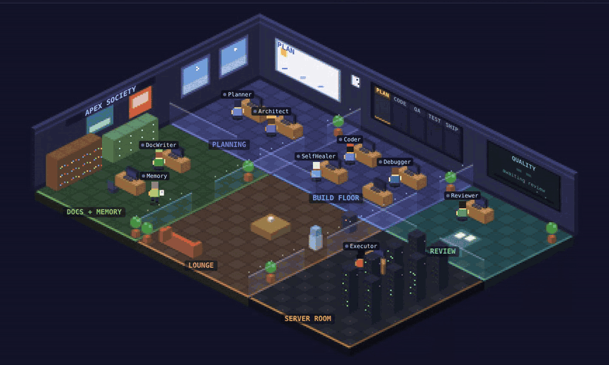

# APEX Society — a 9-agent AI software team

[](https://github.com/mahak867/ai-dev-engine/actions/workflows/ci.yml)


One sentence in, a working project out. Nine agents plan, write, review, **run** and repair the code. The Reviewer can reject the Coder's work and force revisions, and the Executor runs the result in a network-isolated Docker sandbox and sends real test failures back to be fixed.



```bash
pip install "apex-ai-dev-engine[server] @ git+https://github.com/mahak867/ai-dev-engine"
export GROQ_API_KEY=gsk_...          # free tier is enough
apex generate "todo API with auth and tests" --name todo
```

## Why use it

- **It checks its own work by running it.** Most code generators stop at "the model said it's done". Here the generated project is installed, imported and tested in a locked-down container, and failures go back to the agents with the real error output.
- **Safe to point at untrusted output.** Model-chosen file paths can't escape the project folder, generated code never runs on your machine outside the sandbox, and the server is locked down by default. There are tests for each of these.
- **You can see what it costs.** Every run reports tokens, seconds and cost per agent, so you know which agent is expensive.
- **Any model.** Groq, Qwen, OpenRouter, Ollama, or any OpenAI-compatible endpoint (OpenAI, LM Studio, vLLM, LiteLLM) with one environment variable.
- **Four ways in.** A Python function, a CLI, an MCP server for Claude Desktop and Cursor, and a live dashboard.
- **Measurable.** A built-in benchmark compares the team against a single agent on 30 tasks using standard tools, not an LLM judge.
- **Small and readable.** About 3,000 lines of typed Python, one method per pipeline stage, 80% test coverage, no framework.

## Use it

### Python

```python
import apex

result = apex.generate("URL shortener API with tests", name="shortener", sandbox=True)

result.path            # where the project was written
result.quality_score   # Reviewer's score out of 100
result.passed_sandbox  # did it install, import and pass its own tests?
result.usage           # tokens, seconds and cost, total and per agent
```

More in [`examples/`](examples/): progress callbacks, local models, using one agent on its own.

### CLI

```bash
apex generate "blog API" --name blog     # run the team
apex serve                               # live office dashboard on http://localhost:8000
apex mcp                                 # MCP server (stdio)
apex eval --sandbox                      # benchmark: single agent vs the team
apex doctor                              # check providers, Docker and extras
apex models                              # list built-in models
```

### MCP (Claude Desktop, Claude Code, Cursor)

`pip install "apex-ai-dev-engine[mcp] @ git+https://github.com/mahak867/ai-dev-engine"`, then:

```json
{
  "mcpServers": {
    "apex-society": {
      "command": "apex-mcp",
      "env": { "GROQ_API_KEY": "gsk_...", "APEX_SANDBOX": "docker" }
    }
  }
}
```

Tools: `generate_project` (the full pipeline, writes to `~/apex-projects`) plus one tool per LLM agent (`plan_project`, `generate_code`, `review_code`, …). `apex-mcp --http` serves Streamable HTTP on `127.0.0.1:8002/mcp`.

### Dashboard

```bash
apex serve                    # or: GROQ_API_KEY=gsk_... docker compose up
```

A live isometric office: each agent is a tiny worker who walks over to hand off work, talks in speech bubbles, and lights up the server racks when the sandbox runs. Click a worker to inspect their activity and token usage; click the floor to send them somewhere. Tick **demo replay** to watch a run with no API key.

## Models

| Provider | Set | Example model id |
|---|---|---|
| Groq (free tier) | `GROQ_API_KEY` | `groq/llama-3.3-70b` |
| Qwen / DashScope | `QWEN_API_KEY` | `qwen/qwen-plus` |
| OpenRouter | `OPENROUTER_API_KEY` | `or/kimi-k2` |
| Ollama (local) | `OLLAMA_HOST` | `ollama/qwen2.5-coder:32b` |
| **Any OpenAI-compatible API** | `OPENAI_BASE_URL`, `OPENAI_API_KEY` | `openai/<model id>` |

With no model chosen, providers are tried in order until one answers. Pin one for every agent with `APEX_MODEL=groq/llama-3.3-70b` or `apex.generate(..., model=...)`.

## The 9 agents

| # | Agent | Kind | Job |
|---|---|---|---|
| 1 | **Planner** | LLM | Request → JSON plan: stack, files, routes, schema, security notes |
| 2 | **Architect** | LLM | Structure and patterns; runs **in parallel** with the Planner |
| 3 | **Coder** | LLM | Writes every file; revises on rejection |
| 4 | **Reviewer** | LLM | Scores 0–100; rejects on critical or security issues, up to 3 rounds |
| 5 | **SelfHealer** | LLM | Patches leftover review issues and **real sandbox failures** |
| 6 | **Debugger** | LLM | Hunts runtime errors (imports, undefined names, startup crashes) |
| 7 | **Executor** | tool | Syntax check, then install → compile → import → pytest in Docker |
| 8 | **DocWriter** | LLM | README |
| 9 | **Memory** | tool | Learns from past runs and injects lessons into new ones |

```
            Memory ─────────────┐ (lessons from past runs)
                                ▼
 request ─► Planner ∥ Architect ─► Coder ⇄ Reviewer ─► SelfHealer ─► Debugger
                                   (reject / revise,                      │
                                    up to 3 rounds)                       ▼
                         ┌──────────────── Executor (Docker sandbox) ◄────┘
                         │ fail: real error output ─► SelfHealer ─► re-run (≤2)
                         ▼ pass
                      DocWriter ─► project/ + per-agent token & cost report
```

## Benchmark

`apex eval` runs 30 fixed backend tasks through a single agent and through the team, on the same pinned model, and scores the output **without any LLM**:

| Signal | Tool |
|---|---|
| Security findings | Bandit (HIGH / MEDIUM), Ruff `S` rules |
| Hardcoded secrets | Token formats and `getenv("KEY", "literal")` fallbacks |
| Bugs and syntax | Ruff `E9,F,B`, `ast.parse` |
| Does it actually work | Docker sandbox: deps install, app imports, pytest pass rate |
| Cost | Tokens, USD, wall time |

It reports paired per-task differences with bootstrap 95% confidence intervals and win/tie/loss counts. The team gets a fresh memory per task, so it can't learn the test set.

```bash
APEX_MODEL=groq/llama-3.3-70b APEX_SANDBOX=docker apex eval --sandbox   # writes eval-results/<run>/summary.md
apex eval --self-test --limit 3                                         # offline check of the harness
```

> **Results: not yet published for this version.** An earlier hackathon comparison (91 vs 100) was one task scored by the Reviewer agent itself, so it isn't evidence; this harness replaces it.

## Security model

Generated code and model output are untrusted (OWASP LLM05 / LLM06).

| Area | Default |
|---|---|
| File writes | Every model-chosen path goes through `safe_join`: no `..`, absolute paths, `.git/` or symlink escapes; writes are atomic |
| Running code | **Docker sandbox**: `--network none`, read-only root, `--cap-drop ALL`, `no-new-privileges`, non-root, memory/CPU/PID limits, hard timeout. Dependencies are installed host-side as **wheels only** (no `setup.py` runs), and option lines in generated `requirements.txt` are stripped |
| Host processes | The only host-side commands are `docker` and wheel-only `pip`, run with no shell, a minimal environment (no API keys) and process-group kill |
| Network | The server binds `127.0.0.1`; other addresses need `APEX_API_TOKEN` |
| Auth | Bearer token on `/api/*`, `/mcp/*` and the WebSocket when `APEX_API_TOKEN` is set |
| DNS rebinding / CSRF | `Host` and `Origin` allowlists; no wildcard CORS |
| Public demo | `APEX_PUBLIC_DEMO=1` holds no provider keys and refuses to start if any are set; visitors bring their own key (scoped to one run, never stored) or watch the replay; per-visitor rate limit; no shared sessions or memory |
| Memory | 0600 files, secrets redacted, no file contents, pruned to 500 records / 90 days |

## Configuration

| Variable | Purpose |
|---|---|
| `APEX_MODEL` | Pin every agent to one model |
| `APEX_PRICES` | JSON USD per 1M tokens, e.g. `{"groq/llama-3.3-70b":{"input":0.59,"output":0.79}}`; cost is reported as unknown without it |
| `APEX_SANDBOX=docker` | Executor runs projects in Docker and heals from real failures |
| `APEX_SANDBOX_IMAGE` / `_MEMORY` / `_CPUS` / `_TIMEOUT` | Sandbox limits (default `python:3.12-slim`, 512m, 1 CPU, 120s) |
| `APEX_SANDBOX_HEAL_ROUNDS` | Sandbox → SelfHealer retries (default 2) |
| `APEX_MEMORY_DIR` | Where lessons are stored (default `~/.apex/memory`) |
| `APEX_HOST` / `APEX_PORT` / `APEX_API_TOKEN` | Server bind address and bearer token |
| `APEX_ALLOWED_HOSTS` / `APEX_ALLOWED_ORIGINS` | Host and Origin allowlists (`.hf.space` and `https://*.hf.space` wildcards) |
| `APEX_PUBLIC_DEMO` / `APEX_RUNS_PER_HOUR` | Public demo mode and its per-visitor run limit |
| `APEX_MAX_CONCURRENT_JOBS` / `APEX_MAX_TASK_CHARS` | Server limits (2 / 500) |

Deploy the public demo to a Hugging Face Space with `HF_TOKEN=hf_... python scripts/deploy_hf_space.py --space <you>/apex-society`.

## Project layout

```
apex/
  api.py                 public API: generate(), GenerationResult
  cli.py                 the `apex` command
  orchestrator.py        the pipeline, one method per stage
  agents/base.py         the 7 LLM agents
  execution/sandbox.py   Executor's Docker sandbox
  memory/store.py        Memory agent's store (redacted, pruned)
  ai/provider.py         multi-provider router, per-run keys
  telemetry.py           per-agent tokens, cost and latency
  security.py            path containment, no-shell exec, redaction
  syntax_check.py        static syntax validation
  server.py · web/       FastAPI + WebSocket backend and the live office dashboard
  mcp_sdk.py             MCP server (official SDK; stdio and Streamable HTTP)
  evals/                 30-task benchmark, independent scoring, bootstrap statistics
examples/                runnable usage examples
tests/                   unit, pipeline, security-boundary, sandbox (real Docker), MCP and demo tests
```

## Contributing

See [CONTRIBUTING.md](CONTRIBUTING.md). In short: `pip install -e ".[server,mcp,eval,dev]"`, then `ruff check .`, `mypy` and `pytest --cov` must pass. No API key is needed to run the tests.

Built for the [Global AI Hackathon Series with Qwen Cloud](https://qwencloud-hackathon.devpost.com/) (Track 3: Agent Society). MIT licensed.
