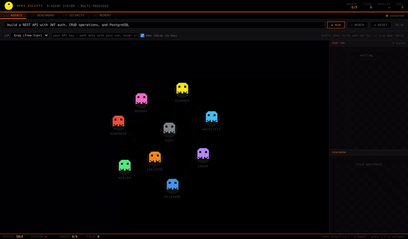

# APEX Society — a 9-agent AI software team

[](https://github.com/mahak867/ai-dev-engine/actions/workflows/ci.yml)

One sentence in, a working project out. Nine agents plan, write, review, **run** and repair the code, and they can disagree: the Reviewer rejects the Coder's work and forces revisions, and the Executor runs the result in a network-isolated Docker sandbox and sends real test failures back to be fixed.



<sub>Dashboard during a demo replay (canned agent outputs, no LLM). Real runs look the same and stream live.</sub>

Built for the [Global AI Hackathon Series with Qwen Cloud](https://qwencloud-hackathon.devpost.com/) (Track 3: Agent Society) · [demo video](https://youtu.be/XBzURya6XAk)

---

## The 9 agents

| # | Agent | Kind | Job |
|---|---|---|---|
| 1 | **Planner** | LLM | Request → JSON plan: stack, files, routes, schema, security notes |
| 2 | **Architect** | LLM | Structure and patterns; runs **in parallel** with the Planner |
| 3 | **Coder** | LLM | Writes every file; revises on rejection |
| 4 | **Reviewer** | LLM | Scores 0–100; rejects on critical/security issues, up to 3 rounds |
| 5 | **SelfHealer** | LLM | Patches leftover review issues and **real sandbox failures** |
| 6 | **Debugger** | LLM | Hunts runtime errors (imports, undefined names, startup crashes) |
| 7 | **Executor** | tool | Syntax check, then install → compile → import → pytest in Docker |
| 8 | **DocWriter** | LLM | README |
| 9 | **Memory** | tool | Learns from past runs and injects lessons into new ones |

```
            Memory ─────────────┐ (lessons from past runs)
                                ▼
 request ─► Planner ∥ Architect ─► Coder ⇄ Reviewer ─► SelfHealer ─► Debugger
                                   (reject / revise,                      │
                                    up to 3 rounds)                       ▼
                         ┌──────────────── Executor (Docker sandbox) ◄────┘
                         │ fail: real error output ─► SelfHealer ─► re-run (≤2)
                         ▼ pass
                      DocWriter ─► project/ + per-agent token & cost report
```

---

## What's measurable

**Per-agent cost and latency.** Every LLM call is attributed to the agent that made it: tokens (from the provider's `usage` block), seconds, and cost when a price is configured. You see it at the end of every dashboard run, in each MCP result, and in the eval report.

**Independent eval harness** ([`eval/`](eval/)). Single agent vs. society on 30 fixed backend tasks, the same pinned model for both, scored **without any LLM**:

| Signal | Tool |
|---|---|
| Security findings | Bandit (HIGH / MEDIUM), Ruff `S` rules |
| Hardcoded secrets | Token formats + `getenv("KEY", "literal")` fallbacks |
| Bugs / syntax | Ruff `E9,F,B`, `ast.parse` |
| Does it actually work | Docker sandbox: deps install, app imports, pytest pass rate |
| Cost | Tokens, USD, wall time |

The report gives paired per-task differences with bootstrap 95% CIs and win/tie/loss counts. The society gets a fresh memory per task, so it can't learn the test set.

```bash
APEX_MODEL=groq/llama-3.3-70b GROQ_API_KEY=... \
APEX_SANDBOX=docker python eval/run_eval.py --sandbox      # writes eval/results/<run>/summary.md
python eval/run_eval.py --self-test --limit 3               # offline check of the harness itself
```

> **Results: not yet published for this version.** The earlier hackathon comparison (single 91/100 vs society 100/100) was one task scored by the Reviewer agent itself, so it isn't evidence; this harness replaces it. Run it and commit `summary.md`.

---

## Use it

### Dashboard

```bash
pip install -r requirements.txt
cp .env.example .env            # add GROQ_API_KEY (free) or QWEN_API_KEY
python server.py                # http://localhost:8000  (binds 127.0.0.1)
```

In the dashboard you can paste a key just for one run, or tick **demo replay** to watch the pipeline with no key.

### MCP server (Claude Desktop, Claude Code, Cursor)

`pip install ".[mcp]"`. Built on the official MCP Python SDK. Tools: `generate_project` (the full 9-agent pipeline, writes to `~/apex-projects`) plus the 7 single-agent tools (`plan_project`, `generate_code`, `review_code`, …). Resource: `apex://agents`.

```json
{
  "mcpServers": {
    "apex-society": {
      "command": "apex-mcp",
      "env": { "GROQ_API_KEY": "gsk_...", "APEX_SANDBOX": "docker" }
    }
  }
}
```

`apex-mcp --http` serves Streamable HTTP on `127.0.0.1:8002/mcp` with DNS-rebinding protection. Non-loopback binds require `APEX_API_TOKEN`.

### CLI

```bash
pip install ".[server]"
apex generate "todo API with tests" --name todo
```

### Public demo (Hugging Face Space)

```bash
HF_TOKEN=hf_... python scripts/deploy_hf_space.py --space <you>/apex-society
```

The Space holds **no** provider keys and refuses to start if any are set. Visitors either watch the demo replay or bring their own Groq/OpenRouter/Qwen key, which is scoped to their run and never stored. Each visitor's runs are rate-limited, and sessions and memory are never shared between visitors.

---

## Security model

Generated code and model output are untrusted (OWASP LLM05 / LLM06).

| Area | Default |
|---|---|
| Network | Binds `127.0.0.1`; non-loopback needs `APEX_API_TOKEN` (or `APEX_PUBLIC_DEMO=1` with no server keys) |
| Auth | Bearer token on `/api/*`, `/mcp/*` and the WebSocket when `APEX_API_TOKEN` is set |
| DNS rebinding / CSRF | `Host` and `Origin` allowlists; no wildcard CORS |
| File writes | Every model-chosen path goes through `safe_join`: no `..`, absolute paths, `.git/`, or symlink escapes; atomic writes |
| Running code | **Docker sandbox**: `--network none`, read-only root, `--cap-drop ALL`, `no-new-privileges`, non-root, memory/CPU/PID limits, hard timeout. Dependencies are installed host-side as **wheels only** (no `setup.py` runs), and option lines in generated `requirements.txt` are stripped |
| Host execution | Off unless `APEX_ALLOW_EXECUTION=1`; no shell, minimal env (no API keys), process-group kill |
| Agent tools | `python_eval` is literal-only; `web_fetch` blocks private, loopback and metadata IPs |
| Memory | 0600 files, secrets redacted, no file contents, pruned to 500 records / 90 days |

---

## Configuration

| Variable | Purpose |
|---|---|
| `GROQ_API_KEY` / `QWEN_API_KEY` / `OPENROUTER_API_KEY` / `OLLAMA_HOST` | LLM providers (cascade: Qwen → Groq; Ollama local) |
| `APEX_MODEL` | Pin every agent to one model, e.g. `groq/llama-3.3-70b` |
| `APEX_PRICES` | JSON USD per 1M tokens, e.g. `{"groq/llama-3.3-70b":{"input":0.59,"output":0.79}}` |
| `APEX_SANDBOX=docker` | Executor runs projects in Docker and heals from real failures |
| `APEX_SANDBOX_IMAGE` / `_MEMORY` / `_CPUS` / `_TIMEOUT` | Sandbox limits (default `python:3.12-slim`, 512m, 1 CPU, 120s) |
| `APEX_SANDBOX_HEAL_ROUNDS` | Sandbox → SelfHealer retries (default 2) |
| `APEX_API_TOKEN` | Bearer token; required for non-loopback binds |
| `APEX_HOST` / `APEX_PORT` | Bind address (default `127.0.0.1:8000`) |
| `APEX_ALLOWED_HOSTS` / `APEX_ALLOWED_ORIGINS` | Host / Origin allowlists (`.hf.space` / `https://*.hf.space` wildcards) |
| `APEX_PUBLIC_DEMO` / `APEX_RUNS_PER_HOUR` | Public demo mode and its per-visitor run limit |
| `APEX_MAX_CONCURRENT_JOBS` / `APEX_MAX_TASK_CHARS` | Abuse / cost limits (2 / 500) |
| `APEX_ALLOW_EXECUTION` | Allow unsandboxed host execution / deploys |
| `APEX_MEMORY_DIR` | Memory location (default `~/.apex/memory`) |

---

## Project layout

```
core/
  orchestrator.py        9-agent pipeline (parallel Planner∥Architect, review loop, sandbox heal loop)
  agents/base.py         the 7 LLM agents
  execution/sandbox.py   Executor's Docker sandbox
  memory/store.py        Memory agent's store (redacted, pruned)
  ai/provider.py         multi-provider router, per-run BYOK keys
  telemetry.py           per-agent tokens / cost / latency
  security.py            path containment, no-shell exec, SSRF guard, redaction
  web_security.py        host/origin/token checks, rate limiting
eval/                    30-task harness, independent scoring, bootstrap stats
apex_mcp.py              MCP server (official SDK; stdio + Streamable HTTP)
server.py · dashboard.html   FastAPI + WebSocket backend and live dashboard
mcp_server.py            REST tool API used by the dashboard
Dockerfile · scripts/deploy_hf_space.py   container + Hugging Face Space deploy
tests/                   unit, security-boundary, sandbox (real Docker), MCP and demo-mode tests
```

```bash
python -m pytest            # sandbox tests run when Docker is available
```

MIT licensed.
